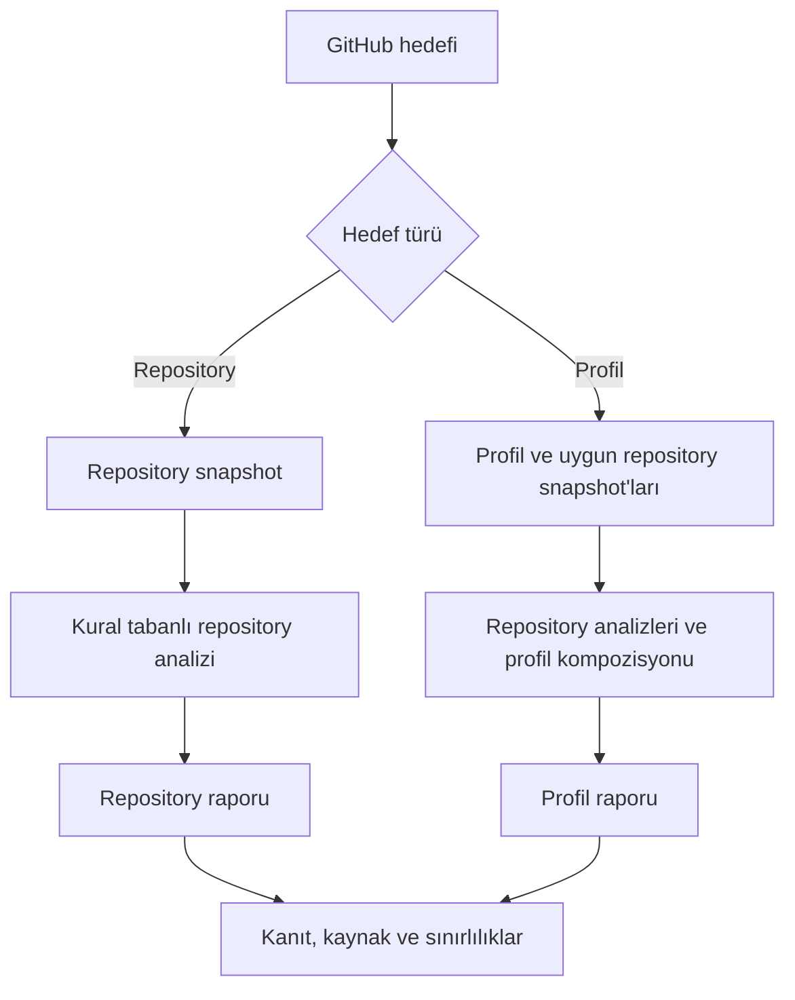

# GitHub Proof

**Evidence, not verdicts.** — Kanıt sunar, hüküm vermez.

GitHub Proof, public GitHub repository ve profillerindeki gözlemlenebilir mühendislik kanıtlarını analiz eden, açıklayan ve kaynağına kadar izlenebilir hâle getiren bir web uygulamasıdır.


## İçindekiler

- [Neden GitHub Proof?](#neden-github-proof)
- [Özellikler](#özellikler)
- [Nasıl çalışır?](#nasıl-çalışır)
- [Kurulum](#kurulum)
- [Kullanım](#kullanım)
- [Mimari](#mimari)
- [Testler](#testler)
- [Proje durumu ve yol haritası](#proje-durumu-ve-yol-haritası)
- [Dokümantasyon](#dokümantasyon)
- [Katkı ve lisans](#katkı-ve-lisans)

## Neden GitHub Proof?

Bir GitHub repository'sinde testler, CI yapılandırmaları, bağımlılıklar ve düzenli commit geçmişi bulunabilir. Ancak bu artefaktların varlığı, tek başına geliştiricinin kodu yazdığını, anladığını veya belirli bir yetkinlik seviyesinde olduğunu kanıtlamaz.

AI coding agent'larının gelişmesiyle bu ayrım daha da önemli hâle gelmiştir.

GitHub Proof, geliştiriciyi değerlendirmek yerine public GitHub üzerinde gerçekten hangi kanıtların görünür olduğunu ve bu kanıtların sınırlarını gösterir.

- Geliştiriciler, public çalışmalarındaki görünür kanıtları ve geliştirilebilir alanları inceleyebilir.
- Teknik değerlendiriciler, public artefaktları kaynaklarına kadar takip edebilir.
- Kanıt eksikliği, yetkinlik eksikliği olarak yorumlanmaz.

```text
Repository Evidence ≠ Human Capability
Repository Evidence ≠ Human Authorship
Repository Evidence ≠ Human Understanding
```

## Özellikler

### Repository Proof

Tek bir public repository'nin görünür mühendislik kanıtlarını 15 tanımlı sinyal ve dört analiz kategorisi üzerinden değerlendirir.

| Kategori | İncelenen kanıtlar |
| --- | --- |
| Repository anlaşılabilirliği | README, açıklama, kurulum, lisans, kullanım örneği veya demo |
| Geliştirme süreci görünürlüğü | Commit geçmişi ve zamana yayılımı, issue, pull request, release |
| Doğrulama ve kullanılabilirlik | Test yapısı ve Continuous Integration |
| Portföy sunumu | Topics, homepage/demo ve sunum bütünlüğü |

Rapor; gözlemlenen kanıtları, sınırlılıkları, belirsizlikleri ve öncelikli iyileştirme önerilerini sunar. Kategori ve toplam skorlar ikincil göstergelerdir; geliştirici puanı değildir. Sunum bütünlüğü bileşik sinyali toplam skora ikinci kez eklenmez.

### Profile Proof

Public bir GitHub profilindeki uygun repository'leri inceleyerek tekil proje analizinin ötesinde, repository'ler arasında gözlemlenebilen kanıtları bir araya getirir.

- Repository uygunluğu ve temsilî repository seçimi
- Repository'ler arasında tekrar eden mühendislik kanıtları
- Teknoloji, bağımlılık ve kaynak referansı gözlemleri (tanımlı kapsama göre)
- Kaynağına kadar izlenebilir sonuçlar ve repository detaylarına geçiş
- Kısmi, erişilemeyen veya yetersiz kanıtın açık biçimde sunulması

Profile Proof'un web akışı uygulanmıştır; public beta için production doğrulaması henüz tamamlanmamıştır.

### Web deneyimi

- Repository ve profil hedefleri için ortak giriş noktası
- Sunucu tarafından raporlanan canlı analiz aşamaları
- Türkçe ve İngilizce arayüz
- Açık ve koyu tema
- Responsive Razor Pages arayüzü

### Analiz sınırları

GitHub Proof bir AI dedektörü, aday sıralama sistemi, kıdem belirleme aracı, güvenlik denetimi veya işe alım karar motoru değildir. Kodun özgünlüğünü, insan tarafından yazıldığını ya da anlaşıldığını doğrulamaz. Private repository'ler, şirket içi çalışmalar ve GitHub dışında kalan üretim hakkında çıkarım yapmaz.

## Nasıl çalışır?



Analiz çekirdeği deterministik kurallara dayanır; aynı girdiler ve analiz sürümleri için tekrarlanabilir sonuçlar hedeflenir. Canlı GitHub verilerinin değişmesi farklı snapshot'lar üretebilir.

Her anlamlı sonuç aşağıdaki izlenebilirlik ilkesine bağlıdır:

```text
Claim → Evidence → Evidence Reference → Observable Source
```

Kanıtın bulunamaması ile otomatik analizin güvenilir bir sonuç üretememesi aynı durum değildir.

## Kurulum

### Gereksinimler

- [.NET 10 SDK](https://dotnet.microsoft.com/download/dotnet/10.0)
- [Git](https://git-scm.com/downloads)
- GitHub API erişimi için internet bağlantısı
- GitHub access token (önerilir; özellikle profil analizlerinde API limitleri nedeniyle)

Repository private olduğu için clone işlemi erişim yetkisi gerektirir.

### 1. Repository'yi klonlayın

```bash
git clone https://github.com/fatihGunalp/github-proof.git
cd github-proof
```

### 2. GitHub API token'ını yapılandırın

Uygulama `GITHUB_TOKEN` ortam değişkenini okur. Token isteğe bağlıdır; token olmadan anonim API isteklerinin limitleri geçerlidir. Yalnız gerekli en düşük izinleri kullanın ve token'ı kaynak koda veya Git geçmişine eklemeyin.

**macOS / Linux (Bash veya Zsh)**

```bash
export GITHUB_TOKEN="YOUR_GITHUB_TOKEN"
```

**Windows (PowerShell)**

```powershell
$env:GITHUB_TOKEN = "YOUR_GITHUB_TOKEN"
```

Token'ı kendi güvenli secret yönetiminiz üzerinden ortam değişkenine aktarmanız önerilir.

### 3. Restore ve build

```bash
dotnet restore GitHubProof.slnx
dotnet build GitHubProof.slnx --no-restore
```

### 4. Web uygulamasını çalıştırın

```bash
dotnet run --project src/GitHubProof.Web
```

Terminaldeki `Now listening on` adresini tarayıcıda açın. Uygulamanın bu çalışma akışı için ayrı bir veritabanı veya LLM API anahtarı gerekmez.

## Kullanım

Ana sayfadaki GitHub hedefi alanına bir public repository URL'si veya public profil URL'si girin.

| Analiz | Örnek girdi |
| --- | --- |
| Repository Proof | `https://github.com/dotnet/runtime` |
| Profile Proof | `https://github.com/torvalds` |

Örnek URL'ler giriş biçimini göstermek içindir; profil uygunluğu, API erişimi ve rapor kapsamı çalışma zamanında belirlenir.

Analizi başlattıktan sonra ilerleme aşamalarını takip edin. Sonuç raporunda önce görünür kanıtları, ardından bu kanıtların kaynaklarını ve sınırlılıklarını inceleyin.

Repository raporu örneği: [Örnek analiz raporu](docs/product/sample-analysis-report.md). Bu belge temsilî bir örnektir, canlı analiz sonucu değildir.

## Mimari

GitHub Proof, C# ve .NET 10 ile geliştirilmiş katmanlı bir solution'dır. Domain ve Application katmanları analiz semantiğini; Infrastructure dış veri erişimini; Web katmanı kullanıcı deneyimini yönetir.

```text
github-proof/
├── src/
│   ├── GitHubProof.Domain/
│   ├── GitHubProof.Application/
│   ├── GitHubProof.Infrastructure/
│   └── GitHubProof.Web/
├── tests/
│   ├── GitHubProof.Domain.Tests/
│   ├── GitHubProof.Application.Tests/
│   ├── GitHubProof.Infrastructure.Tests/
│   └── GitHubProof.Web.Tests/
├── docs/
│   ├── architecture/
│   ├── decisions/
│   ├── product/
│   └── roadmap/
├── samples/
│   └── validation/
├── agents/
├── worklog/
├── AGENTS.md
├── CLAUDE.md
├── GitHubProof.slnx
└── README.md
```

| Katman | Sorumluluk |
| --- | --- |
| [Domain](src/GitHubProof.Domain/) | Analiz modelleri, value object'ler, sinyaller, kurallar ve profil politikaları |
| [Application](src/GitHubProof.Application/) | Analiz orkestrasyonu, repository ve profil kompozisyonu, rapor projeksiyonu |
| [Infrastructure](src/GitHubProof.Infrastructure/) | GitHub REST veri toplama, profil için kontrollü GraphQL desteği, snapshot ve manifest işlemleri |
| [Web](src/GitHubProof.Web/) | ASP.NET Core Razor Pages, giriş sınıflandırma, sunum, localization ve analiz ilerlemesi |

### Teknoloji yığını

| Teknoloji | Kullanım |
| --- | --- |
| C# / .NET 10 | Uygulama ve analiz çekirdeği |
| ASP.NET Core Razor Pages | Web arayüzü ve HTTP akışları |
| GitHub REST API | Public GitHub verilerinin toplanması |
| GitHub GraphQL API | Profile Proof için kontrollü, yapılandırılabilir toplama desteği |
| HTML, CSS, JavaScript | Responsive arayüz, tema ve ilerleme göstergesi |
| xUnit | Otomatik testler |

LLM, deterministik analiz çekirdeğinin zorunlu bir bağımlılığı değildir.

## Testler

Tüm solution testlerini çalıştırmak için:

```bash
dotnet test GitHubProof.slnx
```

Tek bir katmanı test etmek için:

```bash
dotnet test tests/GitHubProof.Domain.Tests
dotnet test tests/GitHubProof.Application.Tests
dotnet test tests/GitHubProof.Infrastructure.Tests
dotnet test tests/GitHubProof.Web.Tests
```

Test kapsamı; domain kuralları, analiz ve kompozisyon, GitHub veri toplama davranışları, rapor sözleşmeleri ve web davranışlarını içerir. Gerçek repository doğrulama örnekleri [samples/validation](samples/validation/) altında tutulur.

## Proje durumu ve yol haritası

Geliştirme tamamlanması ile production release birbirinden ayrı değerlendirilir.

| Yetkinlik | Durum |
| --- | --- |
| Repository Proof | Uygulanmış repository analiz ve web raporu |
| Profile Proof | Web akışı uygulanmış (P10 COMPLETE); Milestone B production gate devam ediyor |
| Job Proof | Ürün sözleşmesi ve yol haritası mevcut; teslim edilmiş özellik olarak sunulmaz |
| Recruiter Evidence View | Gelecek kontrollü pilot yönü |
| LLM destekli anlatım | Gelecek, isteğe bağlı iyileştirme |

Job Proof'un hedefi, iş ilanındaki gereksinimler ile public GitHub üzerinde görünür kanıt arasındaki ilişkiyi izlenebilir biçimde sunmaktır; adayın işe uygunluğunu veya yetkinliğini belirlemek değildir.

Güncel durum: [CURRENT.md](worklog/CURRENT.md) · [Geliştirme fazları](docs/roadmap/mvp-phases.md) · [Deployment milestones](docs/roadmap/deployment-milestones.md).

## Dokümantasyon

Ürün ve mimari sözleşmelerinin kaynak doğrusu `docs/` dizinidir.

| Belge | İçerik |
| --- | --- |
| [Product Positioning](docs/product/product-positioning.md) | Ürün amacı ve çıkarım sınırları |
| [MVP Product Contract](docs/product/mvp-product-contract.md) | Repository Proof kapsamı |
| [Scoring and Report Contract](docs/product/scoring-and-report-contract.md) | Sinyal durumları, puanlama ve rapor |
| [MVP Signal Definitions](docs/architecture/mvp-signal-definitions.md) | Analiz sinyallerinin teknik kuralları |
| [Public Profile Evidence](docs/product/public-profile-evidence-product-contract.md) | Profil analizi kapsamı |
| [Profile Report Contract](docs/architecture/public-profile-evidence-report-contract.md) | Profil raporu ve izlenebilirlik |
| [Job Evidence Alignment](docs/product/job-evidence-alignment-product-contract.md) | Gelecek Job Proof ürün sözleşmesi |
| [Deployment Milestones](docs/roadmap/deployment-milestones.md) | Production yayın kriterleri |

## Katkı ve lisans

Repository'ye erişimi olan geliştiriciler, değişiklik yapmadan önce [AGENTS.md](AGENTS.md) ve [agents/](agents/) altındaki çalışma sözleşmelerini incelemelidir. Değişiklikler odaklı tutulmalı, ilgili testlerle doğrulanmalı ve ürün sözleşmelerini korumalıdır.

Repository şu anda private durumdadır. MIT lisansı önceki README'de planlanmış olsa da mevcut repository'de bir `LICENSE` dosyası bulunmamaktadır. Açık kaynak lisansı veya yeniden dağıtım izni, resmi lisans yayımlanana kadar varsayılmamalıdır.

---

GitHub Proof — Kanıt izlenebilir. Sınır görünür.
